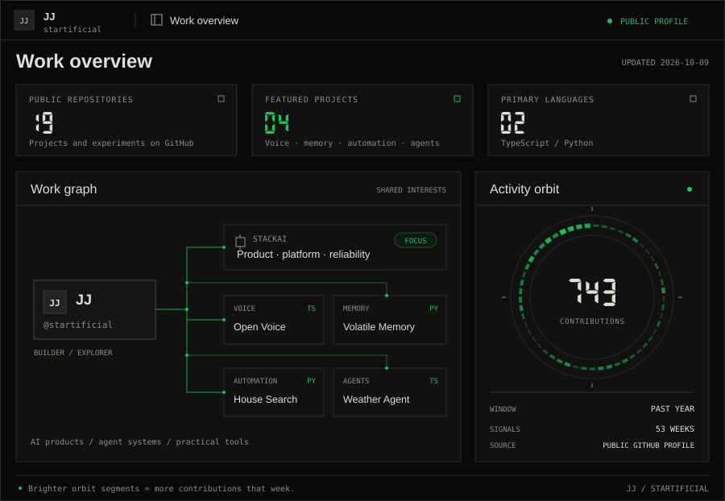

# JJ

**Building AI products, agent systems, and useful things with data.**

I'm interested in the invisible world of data and how it shapes our lives. I like turning that curiosity into working software—from voice interfaces to agents that remember, reason, and get things done.

[GitHub](https://github.com/startificial) · [Hugging Face](https://huggingface.co/startificial) · [Kaggle](https://www.kaggle.com/startificial)

### Work at StackAI

At **StackAI**, I work across AI workflow products and the engineering that makes them dependable: agent experiences, platform and developer tooling, integrations, and product reliability. I care about making complex systems easier to build with, understand, and use.

### Work overview

Public work, mapped. One orbit segment per week; brighter segments mean more contributions. [Data & methodology](./assets/activity-data.json) · [Refresh](https://github.com/startificial/startificial/actions/workflows/refresh-profile.yml)

### Selected public projects

| Project | What I'm exploring |
| :--- | :--- |
| [**Open Voice**](https://github.com/startificial/open-voice) | An open interface for testing voice agents. **TypeScript** |
| [**Volatile Memory**](https://github.com/startificial/memory) | Human-inspired memory for AI agents: decay, reconstructive recall, and evolving behavior. **Python** |
| [**House Search**](https://github.com/startificial/house-search) | Turning apartment search into an automated pipeline with filtering and notifications. **Python** |
| [**Weather Agent**](https://github.com/startificial/weather-agent-example) | A small agent that connects natural-language requests to weather tools and workflows. **TypeScript · Mastra** |

### Tools & interests

**Python · TypeScript · React · SQL** 
AI agents, data engineering, machine learning, and developer experience.

---

Open to collaborating on thoughtful tools for AI and data. Explore a project above or find me on [Hugging Face](https://huggingface.co/startificial) and [Kaggle](https://www.kaggle.com/startificial).
